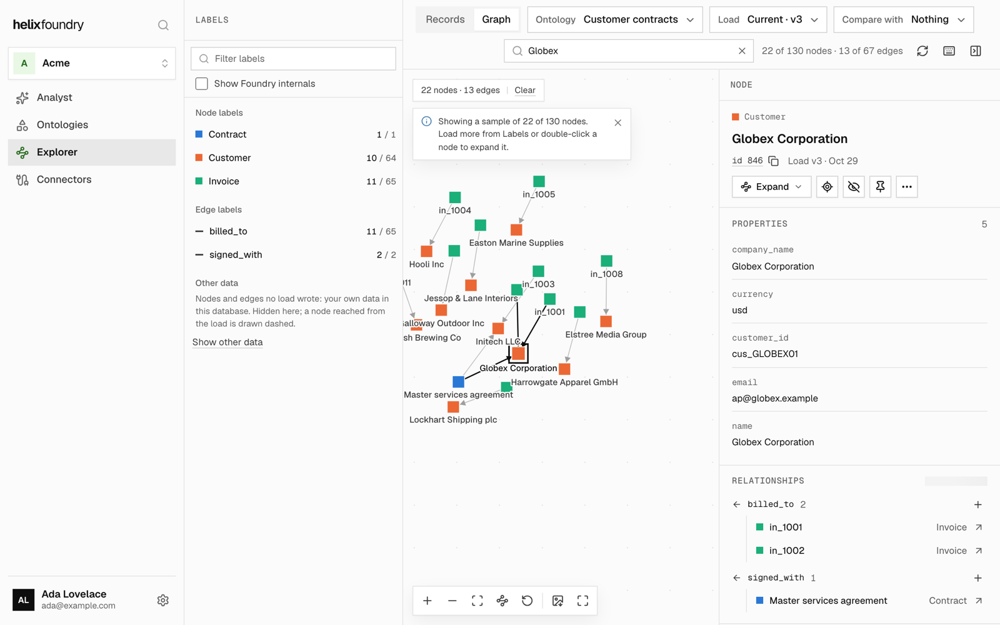
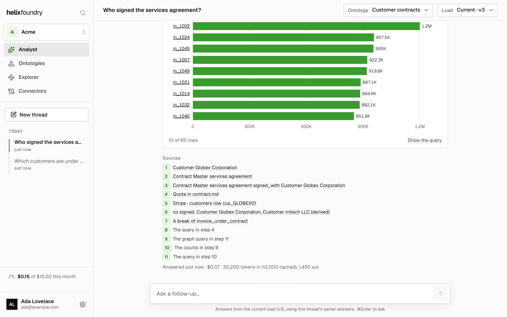

<h1 align="center">
  <picture>
    <source media="(prefers-color-scheme: dark)" srcset=".github/assets/logo-dark.svg">
    
  </picture>
</h1>

<p align="center">
  <strong>Your company's data, connected into one ontology.</strong>
</p>

<p align="center">
  <a href="https://foundry.helix-db.com">Helix Cloud</a> ·
  <a href="https://docs.helix-db.com/foundry">Docs</a> ·
  <a href="#run-it-on-your-computer">Run it on your computer</a> ·
  <a href="LICENSE">Apache 2.0</a>
</p>

Connect your databases, tools and documents, let an agent draft an ontology over them, and load it into [HelixDB](https://docs.helix-db.com) as one connected graph. Explore it, follow every value back to the row or quote it came from, and ask questions with cited answers. Use it hosted at [foundry.helix-db.com](https://foundry.helix-db.com), or run it on your own computer with one command.

<p align="center">
  
</p>

## Get started with your coding agent

**On Helix Cloud.** Open [foundry.helix-db.com](https://foundry.helix-db.com) and click **Set up with your agent**. It copies a prompt for Claude Code, Codex, Cursor or any agent that can run commands. The agent adds the Helix MCP, signs you up through it if you don't have an account yet, and builds your first ontology with you. You never need the Helix dashboard: the agent sends you a link only to sign in or to enter a password or key.

**On your computer.** With [Docker](https://docs.docker.com/get-started/get-docker/) running, paste this into your agent:

```text
Set up Helix Foundry on this computer.

Clone https://github.com/helixdb/helix-foundry.git (or use the copy I
already have), then follow its README.md and local/README.md to start it
with Docker Compose and check that it is up. Ask me before deleting data,
removing Docker volumes or stopping anything that is already running.
When it is ready, give me the URL and tell me what to do next.
```

Approve its `git` and `docker` commands one at a time rather than all `docker` commands up front. You enter API keys and database passwords in Foundry, in your browser: your agent never needs them.

## Run it on your computer

You need Docker with Compose v2, ports 3000 and 8333 free, and room for a few GB of images on the first start.

```sh
git clone https://github.com/helixdb/helix-foundry.git
cd helix-foundry
docker compose up -d --wait
```

Open **http://localhost:3000**. There is no account and nothing to set up: one owner, every connector and feature on, and **My workspace** to start in.

**AI** runs where Foundry finds it: Claude or OpenAI when the shell you ran `docker compose up` from has an `ANTHROPIC_API_KEY` or `OPENAI_API_KEY`, else a model that calls tools in Ollama (`docker compose --profile ollama up -d` runs one beside Foundry, or use Ollama on your computer), else LM Studio on your computer. **Settings › AI models** says which it chose and why, and switches to Ollama, Claude, OpenAI, Azure OpenAI or Amazon Bedrock with your own key, or any OpenAI-compatible server (vLLM, a gateway).

[local/README.md](local/README.md) covers what runs, where data lives, each AI provider, Ollama in Docker, ports, and how to reach databases on this machine.

**What you do next**

1. No data to hand? Click **Use the sample**: Acme Corp, a made-up software company, as a PostgreSQL database (customers, subscriptions, invoices, support tickets, usage) and documents (contracts, call notes, an incident report). It walks you through the data, the goal, a ready-made ontology, its load and a question, in about a minute, once Foundry has an AI provider.
2. Otherwise, connect your data or upload documents, say what you want to know, and let the ontology agent draft the ontology.
3. Review the draft, make it current and load it into HelixDB.
4. Explore the graph and its records, or ask the **Analyst**.

<p align="center">
  
</p>

## What you get

- **Connectors** for PostgreSQL, MySQL, Amazon S3, Stripe, PostHog, WorkOS, GitHub, Linear, Granola, Cal.com, Slack, Notion and Google Workspace, documents (Markdown, text, PDF) and table files (CSV, TSV, JSON, JSON Lines, Parquet). On Helix Cloud, API sources also take records your apps and agents send.
- **Syncs that read only what changed:** PostgreSQL and MySQL change capture where the database allows it, and incremental reads from every other connector.
- **An ontology agent** that drafts types, links, rules, and the tables and documents each comes from, from your data and your goal. You review it, edit it and make a version current.
- **Loads into HelixDB** that keep where every value came from: a table row, or a quote in a document. Values documents disagree on wait for your review.
- **The Explorer:** the graph and its records, each entity's page, and two loads compared side by side.
- **The Analyst:** questions answered from a load, with charts, the queries it ran and a source for every claim.
- **Your choice of AI:** on Helix Cloud, Helix's Claude or, on Foundry Pro, your own key; on your computer, Claude, OpenAI, Azure OpenAI, Amazon Bedrock, Ollama, LM Studio or any OpenAI-compatible server.

## Everyday commands

Run these from the repository.

```sh
docker compose ps                         # status
docker compose logs -f site foundry       # follow logs (Ctrl+C to stop)
docker compose stop                       # stop
docker compose up -d --wait               # start again
git pull && docker compose up -d --wait   # upgrade to the latest release
```

Foundry starts again with Docker unless you stopped it. Your data lives in Compose volumes, which `docker compose down` keeps. **Never run `docker compose down -v`** unless you mean to delete everything: it removes your data and the key that seals every password and API key you gave Foundry.

## Security model

The local install is for one person on their own computer. There is no sign-in, so anyone who can reach it controls it.

- The site listens on `127.0.0.1:3000` only and answers only `localhost:3000`. Never expose it through a reverse proxy, tunnel or port forward.
- The store listens on `127.0.0.1:8333`, for the uploads Foundry signs.
- The first start writes the install's secrets into the `secrets` volume; nothing is printed or written to the checkout. Every credential you enter is sealed with its connector key.
- Ollama in Docker listens on the ontology agent's loopback only, so no other container and nothing outside Docker can reach it.
- A local build loads no analytics and sends no usage data anywhere.

## Documentation

| Document                                                | What it covers                                                                               |
| ------------------------------------------------------- | -------------------------------------------------------------------------------------------- |
| [Helix Foundry docs](https://docs.helix-db.com/foundry) | Using Foundry, hosted or on your computer                                                    |
| [local/README.md](local/README.md)                      | The local install: what runs, AI providers, Ollama, images, ports, databases on this machine |
| [AGENTS.md](AGENTS.md)                                  | The repository's guide for contributors and coding agents: layout, rules, each area          |
| [backend/README.md](backend/README.md)                  | Foundry's Go backend: build, test and run it                                                 |

## Develop

The site, the Foundry app and its same-origin API proxy (Next.js), is at the root. It needs Node 24 and pnpm.

```sh
pnpm install
pnpm dev:mock        # the hosted site against a mock API, on http://localhost:3000
pnpm dev:mock:local  # the local build against the mock
```

The mock stands in for the API and sign-in, so no account or secret is needed. Before sending a change, run `pnpm typecheck`, `pnpm lint`, `pnpm test` and `pnpm e2e` (Playwright; needs `pnpm exec playwright install chromium`). [AGENTS.md](AGENTS.md) describes the layout and the rules.

[`backend/`](backend) is Foundry's backend, the Go module `github.com/helixdb/helix-foundry/backend`: the API, the workers that sync data, draft ontologies, load them into HelixDB and answer questions, and their MySQL store. [backend/README.md](backend/README.md) says how to build, test and run it. Hosted Helix runs the same code as a library.

## License

Everything in this repository, the site and the backend, is [Apache 2.0](LICENSE), and so are Foundry's three images: `foundry-site` and `foundry`, built from it, and `ontology-agent`, the ontology agent's. HelixDB, which `local/compose.yaml` runs beside them, is [Apache 2.0](https://github.com/HelixDB/helix-db) too.
