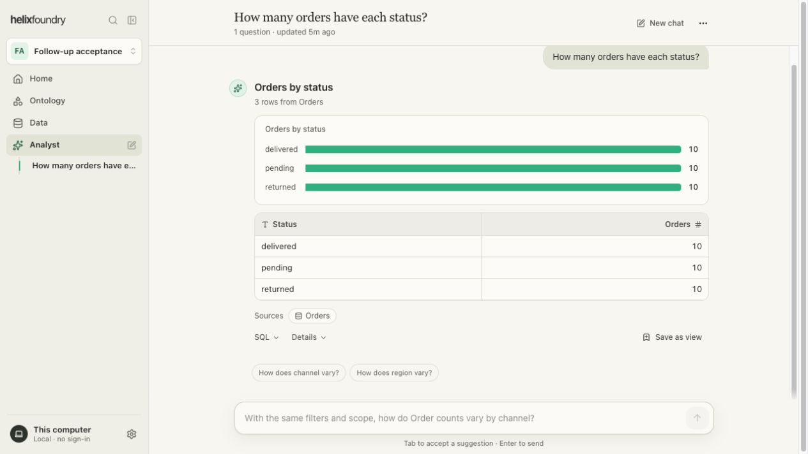
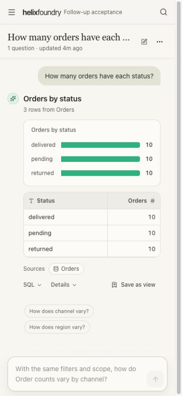

# Contextual follow-ups in Analyst

Implementation for [issue #72](https://github.com/HelixDB/helix-foundry/issues/72). The [HTML design reference](https://github.com/HelixDB/helix-foundry/pull/73) remains separate; these screenshots show the real React chat with synthetic acceptance data.

## Behavior

- Show up to three short question pills below the latest successful answer. Clicking fills and focuses the existing composer; it does not submit.
- Show the primary full question as muted text in an empty composer, and complete matching typed prefixes. Tab accepts; Enter sends through the existing Analyst flow. Escape dismisses, Shift+Enter inserts a line, and unmatched drafts retain ordinary Tab navigation.
- Keep drafts scoped to their workspace and chat. Suggestions disappear while a question runs. Typing or selecting a question pauses an active voice session through the existing GPT-Live controls; live transcripts receive no autocomplete text.
- Reuse project typography, colors, spacing and focus styles. Mobile suggestions wrap inside the composer without horizontal overflow.

## Supported suggestions

The scoped endpoint uses accepted ontology definitions, current dataset profiles and snapshot citations from the latest answer. It offers categorical count breakdowns and daily count explorations, excludes sensitive/key/missing/all-null fields, skips breakdowns already answered in the chat, and returns fewer than three when appropriate. It makes no model calls or row queries to generate suggestions. There are no requests per keystroke.

This first version does not generate arbitrary metric, causal, forecast or multi-dataset join questions. Suggestions are invitations to investigate; answers still go through Analyst's existing validation and query execution.

## Verification

TypeScript, the full Vitest suite, targeted follow-up tests and the production web build passed. Browser acceptance used an isolated MemoryStore workspace, a fixture model provider and the real DuckDB executor: Tab accepted a question, Enter submitted once, the result returned current snapshot citations, and suggestions refreshed. Keyboard selection, dismissal, caret movement, multiline input, pill selection and mobile resize were checked in the actual UI.

Real microphone/provider voice behavior and platform IME input were not exercised in this acceptance session. Existing GPT-Live transport and tool calls are unchanged.
