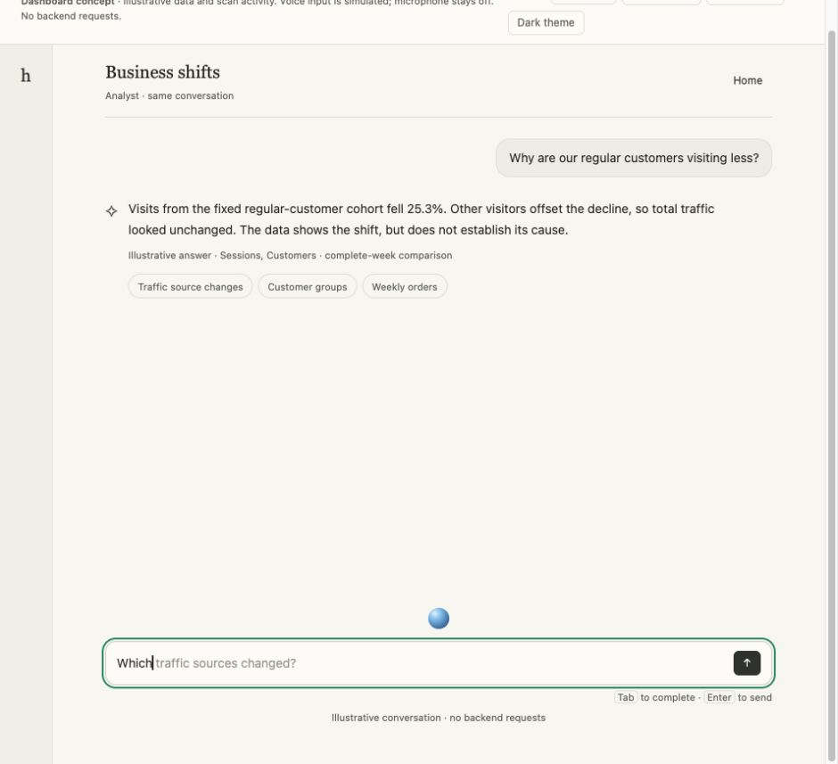
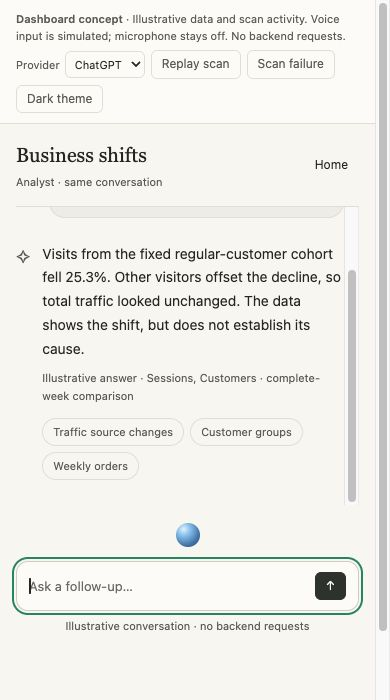
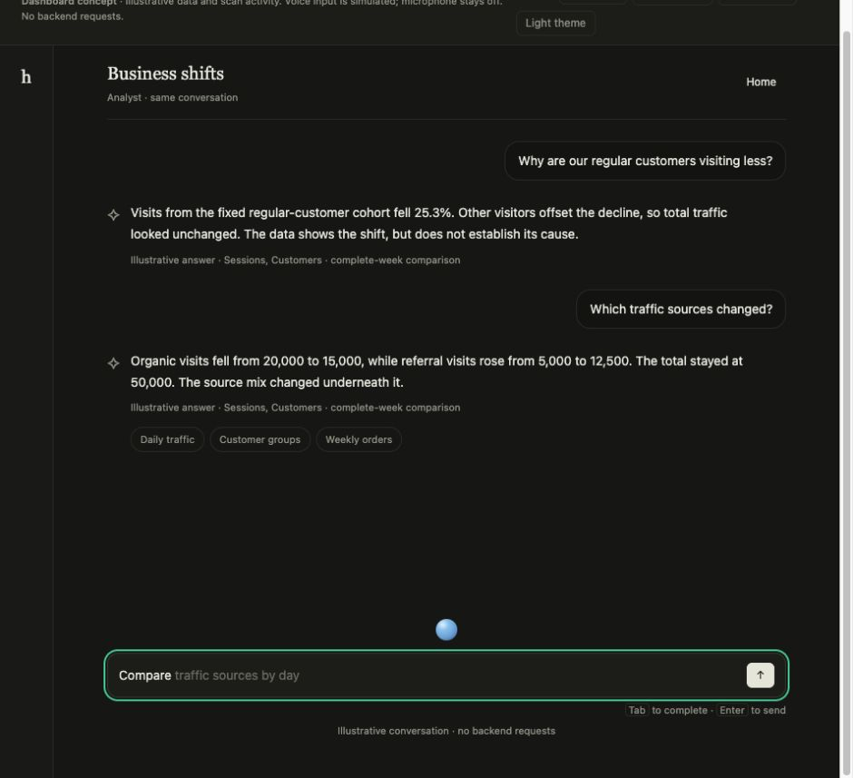

## Why

People often know the first question to ask, but not the useful next question their data can answer. Foundry should help them continue an investigation with relevant follow-ups, rather than leaving an empty composer after every answer.

## What the owner asked for

Show likely next questions based on the accepted ontology and the current conversation. Support **Tab to accept an autocomplete, Enter to send**, or **up to three clickable subtle pills**. Keep this inside the existing chat. This follows the hands-free GPT-Live UX in #54, but suggestions are useful in typed chat too.

## The view and interaction

- After the latest completed answer, show at most three small neutral pills. Use short labels, typically 2–4 words, with the complete question available as the accessible label/tooltip. No large recommendation panel, hero space, tabs or introductory paragraph.
- Suggestions relate to the current answer and available ontology relationships: after a customer-cohort decline, offer traffic-source changes, a customer-group breakdown, or order trends. The prototype examples are illustrative; production must verify each question against the workspace.
- Clicking a pill fills the existing composer and focuses it. It does **not** start a query. The user can edit the question, then press Enter or Send.
- When typed text matches the beginning of a suggested question, show a muted inline completion suffix inside the composer. Keep the user's actual text visually distinct and unchanged until acceptance. Offer one completion at a time, drawn from the same ranked candidates.
- **Tab** accepts the displayed completion and keeps focus in the composer. **Enter** then submits exactly once through the existing chat path. Enter without accepting sends the user's actual text, not the invisible proposed suffix. Normal Send remains available.
- **Escape** dismisses that completion for the current draft; Shift+Tab and Tab without a visible completion retain normal focus navigation. Preserve Shift+Enter, input-method composition, selection, caret movement, multiline editing and existing draft persistence.
- Display pills only under the latest completed answer. Remove stale pills while a new answer is pending; do not repeat three options under every historical answer. Refresh after the next answer. Show fewer or none when relevance/data support is insufficient.
- During live speech, do not append predicted words to the captured transcript or auto-submit suggestions. Explicitly selecting a pill or editing text pauses voice submission/capture according to the existing draft policy, preserving the draft; the user can resume Live deliberately. Voice must remain GPT-Live with real tool calling as required by #54.
- Retain the chat's blue active-session orb above the composer. Suggestions do not add voice actions to cards. Keep Home/chart layouts and theme unchanged.

## How production should choose questions

1. **Resolve supported possibilities.** Use the current accepted ontology and publication generation: entity types, validated measures/units, dimensions, relationships, timestamp coverage and business definitions. Build only question patterns that the current workspace's tools can answer. Entity names alone do not establish a valid join, funnel, profit measure or time series.
2. **Use conversation context.** Combine the latest question, verified answer/evidence, current comparison period and relevant recent thread context. Prioritize a useful next breakdown, comparison or related outcome. Avoid repeating questions already answered, introducing unsupported causal conclusions, or changing dates/cohort definitions silently.
3. **Rank and validate.** Return up to three distinct candidates as structured data: stable ID, short label, full question, supporting ontology references and inherited filters/context. Validate any model-generated candidates against the mapping and tool capabilities before exposing them. Treat suggestions as possible investigations, not business facts. An unavailable join or missing history removes that candidate.
4. **Reuse bounded context.** Generate candidates once after a successful answer or a meaningful context change; cache by workspace, thread/run, accepted ontology version and publication generation. Prefix filtering/completion can happen locally over those validated candidates. Do not call a model, execute analysis or scan graph records on every keystroke.
5. **Handle stale/error states.** Cancel or ignore late suggestion responses when the thread, answer, ontology, workspace or generation changes. A suggestion-service failure must not delay/block the actual answer or normal input. No speculative loading animation in the composer; simply show no suggestions until relevant candidates exist.

Keep model/provider configuration on the server. For the Live integration, expose this through the existing delegated backend/tool workflow rather than implementing a second browser agent or scripted state machine. The frontend only displays validated candidates and handles selection; it does not infer ontology support from the screenshot or cached labels.

## Implementation entry points

- `apps/web/src/areas/analyst/chat.tsx`: show pills for the latest finished answer and connect them to the existing draft/composer.
- `apps/web/src/areas/analyst/prompt-input.tsx`: optional inline completion and keyboard acceptance, preserving current textarea growth, IME and Enter behavior.
- `apps/web/src/areas/analyst/chat-data.ts`, `launcher.ts`: canonical thread/run context and draft persistence.
- `apps/web/src/areas/analyst/reply.tsx`, `answer-view.tsx`: verified answer context and evidence references.
- `apps/api/src/routes/analyst.ts` and the current Analyst/ontology tool harness: scoped suggestion generation, validation and cache invalidation.
- `packages/shared/src/index.ts`: structured candidate contract.
- `docs/DESIGN.md`, shared kit and `analyst.css`: semantic theme tokens, real buttons, visible focus, 11px minimum supporting labels and responsive wrapping.

Inspect current versions and available metadata APIs before choosing exact interfaces. Avoid adding mandatory suggestion payloads to existing responses unless old clients remain compatible. Do not change unrelated dashboard detection or voice transport in this task.

## Acceptance checks

- [ ] Up to three distinct relevant pills only under the latest completed answer; appropriate fewer/empty, pending and failure states.
- [ ] Validated candidates adapt to at least two different ontology fixtures; unsupported relationships/measures, inadequate history and stale publication generations do not yield misleading questions.
- [ ] Pill click fills and focuses without starting a query; edits remain intact. Enter/Send executes one normal follow-up in the same thread.
- [ ] Visible inline suffix matches the typed prefix; Tab accepts it; Enter sends once. Escape dismisses; unmatched drafts and Tab/Shift+Tab continue normal navigation.
- [ ] IME, Shift+Enter, mid-text caret/selection, long/multiline drafts, keyboard and screen-reader descriptions remain usable. Never trap focus when no completion is shown.
- [ ] Voice transcript deltas are never contaminated by predictions; selection/editing cannot trigger an accidental Live business request. GPT-Live prerequisite remains unchanged.
- [ ] Rapid thread/workspace/context changes ignore stale results; no per-keystroke model/query calls, broad scans or duplicate Analyst runs.
- [ ] Desktop, 390px phone, dark theme and reduced motion retain the existing layout; pills wrap without horizontal overflow.

## Interactive design and screenshots

Open the standalone [HTML](index.html) after downloading it, with the fragment `#followups` to show the completed example answer. It requires no server. See [README.md](README.md) for interactions and verification.

This is an interactive design prototype with scripted candidates and answers. Real ontology-backed generation and GPT-Live remain implementation work in #72 and #54.

### Desktop

### Mobile

### Dark theme

